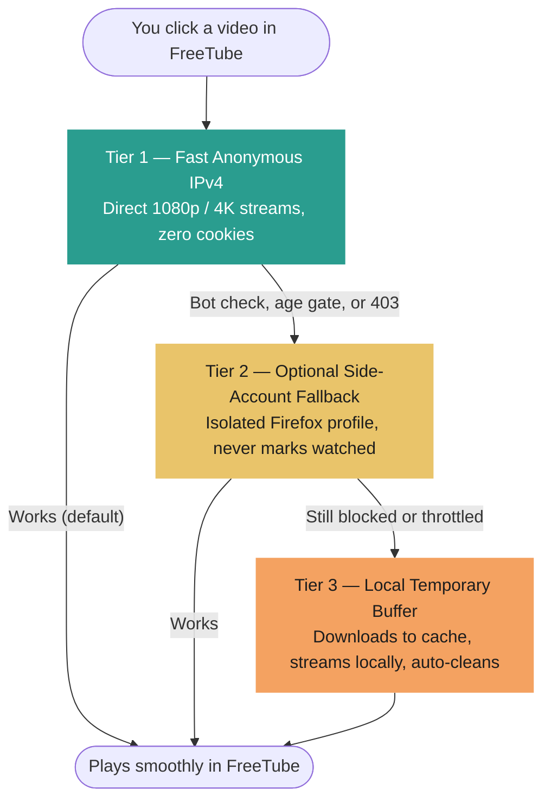

# SteadyTube

**Make stock FreeTube just work.**

SteadyTube is a tiny background helper on your computer that keeps **FreeTube** playing 4K YouTube videos smoothly — without IPv6 bot blocks, SABR buffering loops, flaky public Invidious servers, or switching to a web browser.

- **Works with stock FreeTube** — no fork, no browser extension, SponsorBlock stays intact
- **100% local & privacy-first** — browsing, search, channels, comments, and RSS subscriptions never leave your machine to a third-party server and never touch cookies
- **Pinned to IPv4** — avoids residential IPv6 *"YouTube has blocked your IP"* bans automatically
- **Silent fallback** — if a video ever hits a bot-check, age gate, or mid-video `403`, SteadyTube recovers in the background without popping up errors

---

## How It Works


### Automatic Playback Recovery

SteadyTube always tries **anonymous playback first** and never marks videos as watched. It only steps down the ladder if YouTube blocks a stream:



---

## Quick Start (3 Steps)

### 1. Install with Homebrew

```sh
brew install toni-schmitt/tap/steadytube
```

*(Installs SteadyTube along with `yt-dlp`, `deno`, and `ffmpeg` automatically — no Bun runtime required.)*

### 2. Start in the background

```sh
brew services start steadytube
```

SteadyTube now starts automatically when you log in and listens locally at `http://127.0.0.1:8787`.

### 3. Point FreeTube at SteadyTube

Open **FreeTube → Settings**:

| Setting | Location | Value |
| --- | --- | --- |
| **Preferred API Backend** | General Settings | `Invidious API` |
| **Invidious Instance** | General Settings | `http://127.0.0.1:8787` |
| **Revert to non-preferred backend on failure** | General Settings | **ON** |
| **Fetch Subscriptions Using RSS Feeds** | Subscription Settings | **ON** |
| **Default Video Format** | Player Settings | `DASH Formats` |

That's it — refresh your subscriptions and play any video!

> **Note:** SteadyTube is designed for normal YouTube videos (VODs), channels, search, comments, and RSS subscriptions — not livestreams.

---

## Optional & Advanced Setup

<details>
<summary><strong>Optional: Automatic side-account fallback for age-gated or bot-checked videos (Tier 2)</strong></summary>

Tier 2 is **off by default** — most videos play completely anonymously on Tier 1. Enabling Tier 2 lets SteadyTube silently recover from age-restricted videos or sudden IP bot-checks without touching your everyday browser.

**Why a separate Firefox profile?**
- YouTube invalidates cookies when you browse interactively in the same profile. A dedicated profile that you only open once to sign in stays valid for months.
- Firefox stores cookies without macOS Keychain popups, so background playback works silently.

**Setup (~2 minutes):**

1. Create an isolated profile:
   ```sh
   /Applications/Firefox.app/Contents/MacOS/firefox -CreateProfile "yt-fallback"
   ```
2. Open **only** that profile and sign into a YouTube side-account:
   ```sh
   /Applications/Firefox.app/Contents/MacOS/firefox -P "yt-fallback" --no-remote
   ```
3. *(Recommended)* Visit [myactivity.google.com/product/youtube](https://myactivity.google.com/product/youtube) in that window and turn **YouTube History → OFF**. *(SteadyTube also always passes `--no-mark-watched`.)*
4. Quit that Firefox window and don't use it for daily browsing.
5. Enable it in `~/.config/steadytube/config.json`:
   ```json
   {
     "playback": {
       "authFallback": {
         "enabled": true,
         "cookiesFromBrowser": "firefox",
         "firefoxProfile": "yt-fallback"
       }
     }
   }
   ```
6. Restart SteadyTube:
   ```sh
   brew services restart steadytube
   ```

</details>

<details>
<summary><strong>Optional: PO-token helper (bgutil-ytdlp-pot-provider)</strong></summary>

If you run a local [bgutil-ytdlp-pot-provider](https://github.com/Brainicism/bgutil-ytdlp-pot-provider) HTTP server on `http://127.0.0.1:4416`, SteadyTube automatically detects it and passes it to `yt-dlp`. If it isn't running, SteadyTube skips it with zero delay.

</details>

<details>
<summary><strong>Config file, logs, and uninstalling</strong></summary>

| Purpose | Path (macOS) |
| --- | --- |
| Config file (optional) | `~/.config/steadytube/config.json` |
| Temporary video cache (auto-cleaned) | `~/Library/Caches/steadytube/` |
| Logs | `~/Library/Logs/steadytube/daemon.log` |

**Check status:**
```sh
curl -s http://127.0.0.1:8787/api/v1/stats
```

**View live logs:**
```sh
tail -f ~/Library/Logs/steadytube/daemon.log
```

**Uninstall:**
```sh
brew services stop steadytube
brew uninstall steadytube
```

<details>
<summary>All available <code>config.json</code> options (with defaults)</summary>

```json
{
  "host": "127.0.0.1",
  "port": 8787,
  "logLevel": "info",
  "playback": {
    "videoCacheTtlSec": 1800,
    "ytDlpTimeoutMs": 25000,
    "streamStallTimeoutMs": 15000,
    "enableBgutilPot": true,
    "bgutilPotUrl": "http://127.0.0.1:4416",
    "authFallback": {
      "enabled": false,
      "cookiesFromBrowser": "firefox",
      "firefoxProfile": ""
    },
    "ephemeralBuffer": {
      "enabled": true,
      "maxCacheBytes": 2147483648,
      "ttlSeconds": 3600,
      "maxFormatHeight": 1080
    }
  },
  "rss": {
    "cacheTtlSec": 300,
    "maxConcurrentUpstream": 32
  },
  "thumbnails": {
    "cacheTtlSec": 1800,
    "maxEntries": 1000
  }
}
```

</details>

</details>

<details>
<summary><strong>Run from source (without Homebrew)</strong></summary>

Requires [Bun](https://bun.sh), `yt-dlp`, `deno`, and `ffmpeg`:

```sh
git clone https://github.com/toni-schmitt/steadytube.git
cd steadytube
bun install

# Run in the foreground:
bun run start

# Or install as a macOS Login Item (LaunchAgent):
./scripts/install-launchagent.sh
# Remove later with:
./scripts/uninstall-launchagent.sh
```

Run checks:
```sh
bun run typecheck
bun test
```

</details>

---

## License

MIT — see [LICENSE](LICENSE).

## AI Honesty

This project was completely generated by LLMs.

<a href="https://www.aihonestybadge.com" target="_blank" rel="noopener"></a>
